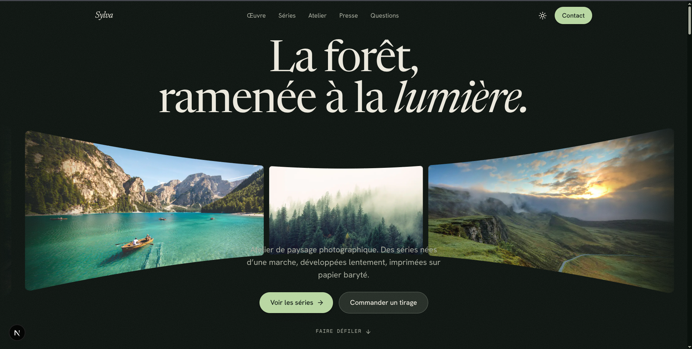

# SYLVA — Landscape Photography Atelier

A **warm, immersive portfolio experience** built with Next.js, Tailwind CSS, and TypeScript, featuring a photographic "passe-partout" aesthetic, choreographed motion design, and a multi-page architecture.

---

## Features

- Curved 3D hero where photographs stream around the inside of a cylinder, built in pure CSS transforms with edge fades and reduced-motion support
- Custom WebGL2 dither-helix carousel that breaks images into print grain as they recede, finite by design and handing the wheel back to the page at both ends
- Filterable series gallery whose cards glide to their new place on filtering, linked to detail pages through shared-element view transitions
- Scroll-triggered reveals, rolling numerical counters, and pointer reactions limited to fine pointers with no reduced-motion preference
- Draggable press carousel and smooth FAQ accordion that track the pointer 1:1 and stay interruptible
- Contact form powered by a Server Action with live validation, pending states, and toast feedback
- Dual "passe-partout" theme with warm baryta-paper light mode and a darkroom dark mode, driven by OKLCH design tokens with no flash on load, shared at runtime by the WebGL carousel and halftone canvas footer
- Multi-page responsive architecture with a fixed navigation tracking the active section, series detail pages, a custom 404, and SEO essentials (Open Graph, sitemap, robots)

---

## Technologies Used

- **Next.js 16 (App Router)** – React framework with Cache Components, Turbopack, static generation, and Server Actions
- **React 19** – Component-based UI architecture and modern React hooks, including View Transitions
- **TypeScript** – Strongly typed JavaScript for robust scalability and maintainable development
- **Tailwind CSS v4 + shadcn/ui** – Utility-first styling with design tokens in `globals.css` and Base UI primitives
- **Motion + Number Flow** – Layout animations, springs, drag gestures, and animated counters
- **WebGL2 + CSS 3D transforms** – Custom shader pipeline for the carousel and perspective geometry for the hero
- **Custom Google Fonts** – Newsreader (Display), Hanken Grotesk (Body), and Geist Mono (Data)

---

## Preview

